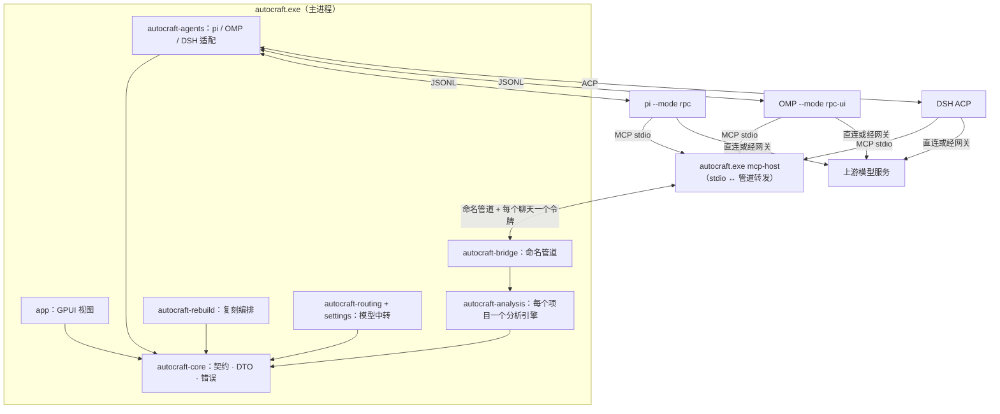
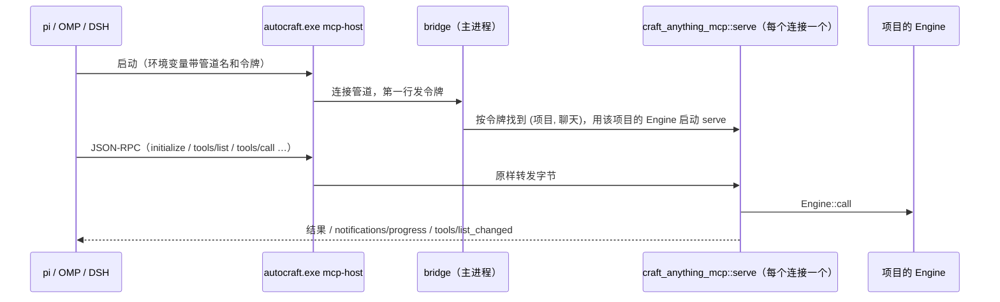

# 概要设计

本文给出 autocraft 的范围、结构和主要取舍。接口和行为细节见 [详细设计](详细设计/README.md)。

## 1. 范围

autocraft 是一个 Windows 优先的原生桌面应用，把三件事放在一个窗口里：

1. **逆向工作台**：打开程序、应用包、网页包或游戏文件，查看函数、字符串、导入、节、类、模块、资源，以及伪 C、反汇编、Hex、调用图，所有结论都带证据。
2. **Agent 分析**：pi、OMP、DSH 通过分析工具研究目标，结论写进同一本证据账本。工作台和 Agent 看到的是同一份数据。
3. **复刻**：研究 → 构建 → 检查 → 收敛，由 pi、OMP 或 DSH 担任构建方。

同一个项目有两个视图：**项目视图**（Make、进度、提问卡、审批卡，给不熟悉逆向的人用）和**工作台**（完整的逆向面板），用顶栏切换。

不做的事：

- 不支持 pi、OMP、DSH 以外的 Agent，也没有自带的 Agent 循环；模型循环、历史和内置工具都由引擎自己负责。
- 不使用 craft-anything 的 egui 界面、CLI、`setup` 和 `ai` crate。
- 不改写外部 Agent 的配置文件：三个引擎的配置在启动时由 autocraft 投影进去。

## 2. 依赖

craft-anything 的库 crate 不拷贝源码，在根 `Cargo.toml` 里以 Git 依赖固定到同一个完整提交号，并改名引入：

| 别名 | crate | 用途 |
|---|---|---|
| `ca-engine` | `craft-anything-engine` | 分析引擎、工作区、feed、inbox、提问、审批策略、`project_*` 工具；开 `wasm-plugins` 特性 |
| `ca-mcp` | `craft-anything-mcp` | 进程内的 MCP 服务器，Agent 看到的工具面由它提供 |
| `ca-evidence`、`ca-engines`、`ca-formats`、`ca-platform` | 同名 crate | 证据类型、外部引擎、格式解析、外部进程 |
| `ca-testkit` | `craft-anything-testkit` | 测试夹具 |

规则：

- 只有 `autocraft-analysis`、`autocraft-rebuild` 和组装根（app）依赖 craft-anything；`core`、`ui` 只认 autocraft 自己的类型。
- 不依赖 `craft-anything-ai`：复刻编排在 `autocraft-rebuild` 里重写，每个模块开头注明它参考的 craft-anything 文件和提交。
- 升级流程和 LumaKit 相同：改 `rev`，用 `cargo metadata` 更新锁文件，跑完整验证。不允许 path 依赖。

## 3. 系统结构

### 3.1 进程

- 分析引擎只在主进程里运行。Agent 的工具调用、界面操作、复刻的检查都落到同一个 `Engine` 上，写同一本证据账本，所以界面能马上看到 Agent 的发现。
- 外部分析工具（Ghidra、adb、Frida、JADX 等）通过 craft-anything 的 `platform::process` 启动，带截止时间、输出上限和 Job Object 清理。

### 3.2 crate 分层

| crate | 职责 | 依赖 |
|---|---|---|
| `autocraft-core` | 领域类型、强类型 id、服务 trait、错误码、事件、DTO | serde、thiserror、uuid、`lumakit-support`；无 I/O、无 UI |
| `autocraft-analysis` | `AnalysisService`、`ProjectService`、`InboxService` 的实现；项目注册表；每个项目一个 `Engine`；分析通道服务端 | core、`ca-engine`、`ca-mcp`、`ca-evidence` |
| `autocraft-rebuild` | 复刻编排：研究、构建、检查、收敛；目标类型与检查注册表；构建方会话；feed 与进度事件 | core、`ca-engine`、`ca-engines`、`ca-formats`、`ca-evidence`、`ca-platform`；只通过 core 的 `AgentRuntime` 使用引擎 |
| `autocraft-agents` | pi、OMP、DSH 三个 `AgentRuntime`；每次启动的投影（技能、规则、MCP、提供方） | core；不依赖 craft-anything、不读库 |
| `autocraft-bridge` | 管道服务端、令牌、`mcp-host` 转发 | core、interprocess |
| `autocraft-routing`、`autocraft-settings` | 模型中转、网关、密钥、MCP 投影；数据库 `autocraft.db` | core |
| `autocraft-terminal`、`autocraft-observability`、`autocraft-ui` | PTY；日志；视觉令牌、字体、无状态组件 | —— |
| `autocraft-testkit` | 测试夹具 | —— |
| `autocraft`（app） | 组装根、GPUI 视图；具体服务只在 `services.rs` 里创建 | 以上全部；视图不直接调用 craft-anything、不读库、不起进程 |

服务 crate 之间互不依赖，引擎适配器之间互不调用。

`AnalysisService`（`crates/core/src/analysis.rs`）是界面和 Agent 共用的入口：`open` / `close` 项目，`view` 取快照（拿不到引擎锁时返回上一次的快照并标记过期），`call` 运行一个工具（可取消），`tools` 给命令面板列出工具，`evidence` 取一条证据，`set_mode` 切换净室 / 深度，`busy` 不阻塞地返回正在运行的工具，`settings` / `set_settings` 读写分析引擎设置。工具结果在 core 里用 `serde_json::Value` 表示。

## 4. 状态归属

| 状态 | 权威所有者 | 其他层保存的内容 |
|---|---|---|
| 提供方、端点、模型、密钥、全局默认模型和力度、默认 Agent、MCP 服务器、聊天绑定 | `autocraft.db` | 设置页投影；密钥只显示掩码 |
| 项目的选择：构建方 Agent、默认模型和力度 | `autocraft.db` 的 `project_prefs` 表，按项目 id 存 | 项目视图、Make 页投影 |
| 素材生成密钥（fal.ai） | `autocraft.db` 的 `asset_keys` 表 | 打开项目时注入 craft-anything 的 `AssetKeys` |
| 项目列表 | craft-anything 的 `Workspace`，位于项目位置（默认用 craft-anything 的默认项目目录） | 项目列表投影 |
| 目标、证据账本、未知项、注释、调查记忆、journal | 每个项目的 `investigation.cany` | `AnalysisView` 投影，按代际丢弃过期结果 |
| 复刻进度、feed、提问和审批、按类别的审批策略 | 项目的 `craft.json`、`feed.json`、`inbox/` | 项目视图投影 |
| 分析引擎设置：外部引擎路径、Ghidra、Auto 模式、构建参数、深度模式默认值、插件 | `<data>/analysis/config.toml`（经 `Session::isolated` 指定目录） | 设置页“分析引擎”投影 |
| 引擎的 transcript、模型、压缩 | 引擎自己的原生存储 | `SessionSnapshot` 投影 |
| 窗口布局、当前视图、页签、选区 | 窗口内存；最近项目和视图、界面语言、外观记在 `app_prefs` | —— |

数据目录默认 `%USERPROFILE%\.autocraft`（项目位置以外的数据与日志），可以用 `--data-dir` 指定；数据库默认在 `<exe>/data/autocraft.db`，指定 `--data-dir` 时在该目录。craft-anything 的配置目录固定为 `<data>/analysis/`，autocraft 不读写 craft-anything 自己的默认配置目录。

## 5. Agent 接入

### 5.1 一个聊天的启动

1. `router.prepare(project, backend)` 返回 `EngineRouting`：提供方、模型、用户 MCP 都在这里投影。
2. `analysis.open(project)` 确保项目的 `Engine` 已经加载。
3. `bridge.register(scope = (project, chat), channel = Analysis, options)` 返回一个令牌。
4. 组装 `StartSession`：`cwd` 是项目根目录，构建方用 `app/`；`analysis` 是 `mcp-host` 的启动参数和令牌。
5. `runtimes[backend].start(req, sink)`。

### 5.2 分析通道

Agent 看到的工具 id、toolset、渐进启用、执行确认、响应预算、prompts 和 resources 都来自 `craft_anything_mcp::serve` 本身，autocraft 不重写。

- `mcp-host` 只转发字节，不解析内容；管道是带令牌的双向字节流，所以服务端主动发出的通知也能到达引擎。
- 三个引擎的注册方式：pi 在扩展里调用 `registerMcpServer`；DSH 放进 `session/new` / `session/resume` 的 `mcpServers`；OMP 合并写入 `mcp.json` 的 `autocraft-analysis` 条目，并在投影的配置里设 `tools.xdev: false`。
- **渐进启用**：一开始只列 core 工具和 `list_toolsets` / `enable_toolset`，启用 toolset 后发 `tools/list_changed`。三个引擎都会刷新工具列表，所以都不开全量列出（`ALL_TOOLS` 全为 `false`）。
- **执行确认**：需要确认的工具会往项目 inbox 投一张审批卡并等待回答；Agent 发起的确认、`core_person_ask` 提问、`core_action_approve` 审批都走同一条路（§6）。
- **响应预算**：用 craft-anything 的默认值，超出时经 `over_limit` → `evidence://` 分页。
- **长任务**：pi、OMP 用 600 秒超时加 progress 通知。DSH 的 MCP 调用固定 60 秒超时、progress 不续时，所以会启动外部进程、访问网络或需要 Ghidra / Frida / 浏览器的工具（按工具的 `Effects` 和 `Requires` 判断）在 DSH 下先立即返回“已开始”，后台照常执行，完成后把结果和证据 id 作为一条 follow-up 发回同一个聊天。
- **串行**：`Engine` 在工具运行期间持有 session 锁，同一项目里的 Agent 调用和界面操作是串行的。界面用非阻塞的 `busy()` 显示“正在运行：<工具>”。

### 5.3 技能与系统提示

autocraft 自有的分析技能和规则用英文写给 Agent 看，不经过界面翻译：先看证据、结论引用证据 id；先取摘要再分页取细节；维护调查记忆；区分观察到的事实和推断，不确定的写成未知项；会执行代码的工具要经过确认。

注入方式：pi 用 `--skill` 加 `systemPromptOptions.sections`，OMP 用 `skills.customDirectories` 加扩展，DSH 用 patch 里的 `personaPrefix` / `customSkillDirs`。

### 5.4 模型配置

所有模型调用都由引擎发出，经 autocraft 的中转配置：提供方、多端点（OpenAI Chat / Responses / Anthropic）、多密钥轮换、模型列表；直连或回环网关（每个聊天一个令牌，由网关换成真实密钥）；全局默认模型和力度、默认 Agent、每个引擎的提供方选择（统一网关 / 引擎官方 / 指定一个提供方）。craft-anything 的 `[ai]` 配置在 autocraft 里没有读者。

模型的优先级：聊天头部的模型选择器（只影响当前会话）→ 项目的选择（这个项目的新会话：分析聊天、复刻构建方、“只是问问”）→ 全局默认。项目里选的模型被删除或停用时，新会话报错并提示重选，不会悄悄换成别的模型。细节见 [模型与设置](详细设计/04-模型与设置.md)。

## 6. 交互：提问、审批、执行确认

| 来源 | 例子 | 怎么到达界面 | 怎么回答 |
|---|---|---|---|
| 引擎自己 | OMP `extension_ui_request`、DSH `session/request_permission`、pi 的对话框 | `SessionSnapshot.interactions` | `AgentSession::respond` |
| 分析工具 | 执行确认、`core_person_ask`、`core_action_approve` | 项目 inbox 里的请求，由 `InboxService` 推给界面 | `InboxService::answer` |

- 两种来源在聊天和项目 feed 里用同一套卡片；卡片关闭、聊天停止、引擎退出都按取消处理。
- **普通聊天**：引擎的权限请求必须由用户显式回答。
- **复刻构建**：构建方的动作先过 `core_action_approve` 的策略。按 `ActionKind`（Web、Commands、OutsideFiles、Publish、DeleteOutside、System、OtherTools）分类，每类可设为默认、允许、询问、拒绝；Auto 模式下没有单独设置的类别，可撤销的动作自动放行，其余拒绝。只有结果是“询问”的动作才弹卡片。三个引擎的权限请求（OMP 结构化扩展钩子、DSH `session/request_permission`、pi 扩展里的 `tool_call` 钩子）都在 `autocraft-rebuild/src/approvals.rs` 里映射成同一次判定，构建会话不显示引擎自己的权限卡。

## 7. 复刻流程

研究（网站抓取或本地分诊）→ 构建（构建方在 `app/` 目录里写代码）→ 检查（能否构建、网页多种屏宽的视觉相似度、截图、玩法表、署名）→ 收敛（把检查结果作为下一轮消息）。

- 项目文件用 craft-anything 的格式（`craft.json`、`feed.json`、`inbox/`、`questions.json`），由它 engine 层的 `Workspace` 读写；格式版本检查（新版本只读不覆盖）照常生效。
- 检查只组合分析工具（`web_site_open`、`web_site_capture`、`web_page_states_capture`、`web_pixels_compare`、`native_window_capture`、`runtime_walkthrough_record` 等），不另写图像比较或抓取逻辑。
- 构建方通过分析通道调用工具，中途可以用 `rebuild_check` 自查。
- 游戏的原文件由构建方自己调用 `game_*` 工具读取；`assets_*` 素材生成工具照常可用。

| 模块（`crates/rebuild/src`） | 职责 |
|---|---|
| `run/` | `RebuildService`（`run/service.rs`）：开始、暂停、继续、补充说明、撤回、停止，并行上限与排队；一次运行的状态机、取消、每轮时限 |
| `study.rs` | 网站抓取、本地分诊、深度模式下的 JS 与窗口观察 |
| `builder.rs`、`session_copy.rs` | 构建方会话：启动、事件转换、恢复；每轮把会话文件复制进项目 |
| `approvals.rs` | 引擎权限请求到 `core_action_approve` 的映射 |
| `brief.rs` | 构建 brief、follow-up、继续、收敛消息 |
| `kinds/`、`stacks.rs` | 目标类型注册表（网站、应用、游戏、自己的项目）与技术栈表 |
| `checks/` | 构建、网页视觉、截图、运行记录、玩法表、署名、自查、WASM 插件检查 |
| `feed.rs`、`activity.rs`、`notes.rs` | `feed.json`、活动日志、补充说明 |
| `question.rs` | “只是问问”：用只读会话回答关于构建的问题 |
| `tools.rs` | `rebuild_*` 工具，创建项目 `Engine` 时经 `Engine::shared_with` 注册 |

细节见 [复刻编排](详细设计/05-复刻编排.md)。

## 8. 界面

- 视觉令牌、组件和布局规则统一（Roles、尺寸、Geist / JetBrains Mono、Lucide 图标），视图里不写颜色和像素常量。
- `Workbench` 持有 `MainView { Home, Project, Workbench }`，主区域按它切换；每个项目记住上次用的视图。
- Agent 对话在两个视图里都在，切换视图不会中断。
- 每个结论都能点开查看证据、置信度和来源工具；地址和函数名可以跳到工作台对应位置。
- 首页有三个入口：做我自己的版本、改我的项目、只看里面。
- 中英双语用 `rust-i18n`（`crates/app/locales/ui.yml`），英文是 source locale，中文完整；工具 id、Agent 回复、工具结果、证据、提示词、技能和日志不翻译。

视图、组件和设置页的细节见 [界面](详细设计/06-界面.md)。

## 9. 错误、日志、安全

- **错误**：craft-anything 的 `ToolError` 在 `autocraft-analysis` 的边界上转换成 autocraft 的错误码，保留修复建议，界面原样显示。错误码和日志规则见 [错误日志与测试](详细设计/07-错误日志与测试.md) 和 [日志与异常规范](日志与异常规范.md)。
- **崩溃隔离**：分析工具在 `catch_unwind` 里运行；`autocraft-analysis` 的后台任务各有 panic 边界，一个项目的引擎出错不会拖垮整个应用。
- **执行外部代码**：带 `EXECUTES_FOREIGN_CODE` 或 `MUTATES_DEVICE` 的工具一律经过 §6 的确认，没有全局放行开关。
- **密钥**：只出现在数据库、宿主内存和直连时引擎子进程的环境变量里。管道令牌每个聊天一个，聊天释放时撤销。
