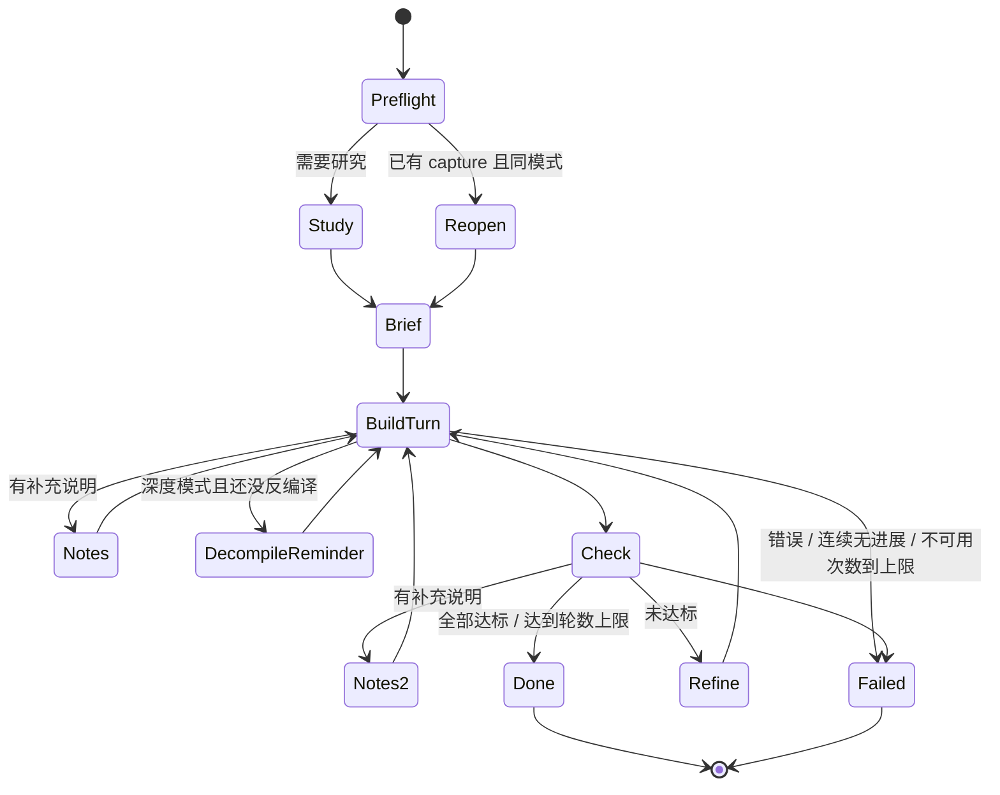

# 05 复刻编排（`autocraft-rebuild`）

复刻编排驱动构建方（pi、OMP、DSH 的 `AgentSession`）在项目的 `app/` 里重建目标，并反复对照原作检查。项目文件格式（`craft.json` 清单、`feed.json`、`questions.json`、`usage.json`、`inbox/`、`checks/`）沿用 craft-anything `engine` 的工作区模块；本 crate 只依赖 craft-anything `engine` 和 core。

## 1. 模块

| 模块 | 职责 |
|---|---|
| `lib.rs` | `RebuildHub`：实现 `RebuildService`；排队与并行上限；启动时修正中断的项目 |
| `run/mod.rs`、`run/service.rs` | 一次运行：线程、取消、事件发送、收尾状态；自查请求入队 |
| `run/flow.rs` | 状态机（§2） |
| `run/turn.rs` | 一轮构建：发送、轮询、重试、会话副本（§5.3） |
| `run/check.rs` | 检查轮次、沿用结果、回答自查 |
| `run/usage.rs` | 用量记账（§12） |
| `study.rs` | 研究（§3） |
| `builder.rs` | 构建方会话的启动与恢复接口 |
| `session_copy.rs` | 会话副本与交接文字（§5.1） |
| `approvals.rs` | `ActionPolicy` 实现（§4） |
| `brief.rs` | 提示词（§6） |
| `kinds/`、`stacks.rs`、`stacks.toml` | `TargetKind` 注册表（website、app、game、own）与技术栈表 |
| `checks/` | `Check`、`CheckCx` 和各项检查（§10） |
| `notes.rs` | 补充说明（§7） |
| `question.rs` | 只是问问（§8） |
| `feed.rs`、`activity.rs` | feed 记录、活动日志（§9） |
| `tools.rs`、`tools/` | `rebuild_*` 工具（§11） |

不做：抽取原作资源的 Extractor、只给 API 循环用的 `build_*` 工具、SSH 远程构建。WASM 插件检查（`checks/plugins.rs`）在内置检查通过后执行，文件正文由各检查声明的扩展名决定。

## 2. 状态机



| 步骤 | 规则 |
|---|---|
| **Preflight** | 1. `BuildProgress::load`，有新要求（`message` 非空）时 `reset` 并保存。<br>2. 检查构建方引擎已安装，否则 `NeedsYou`：“{Agent} 没有安装，去编码搭档安装”。<br>3. 打开分析 Engine 并 `hold(Run)`；清空上一次运行遗留的 `inbox/notes/`。<br>4. 创建 `app/`。<br>5. `manifest.stack` 为空时用 `KindRegistry::choose` 选技术栈并保存。<br>6. 用 `KindRegistry::detect` 确定 `TargetKind`，失败返回 `INVALID`：“描述一下要做什么：网站、应用还是游戏”。<br>7. 读一次当前模式 `deep`，本次运行全程用它。 |
| **是否研究** | `first = !capture 存在 ‖ (无 message ‖ 本模式没有保存的会话) ‖ (本模式没有会话 ‖ 另一模式有)`；`carrying_on = 本模式有会话 && (continuing ‖ 无 message)` |
| **会话选择** | 构建方 Agent 与上次保存会话的 Agent 不同（`manifest.agent_session_by != backend`），或会话保存的模式与本次不同（`agent_session_deep != deep`）时，不沿用会话 |
| **首个提示** | `message` 有值且不是首次且有会话：follow-up；无 message 且 carrying_on：continue；否则 brief。保存过会话但恢复不了时改用 `resumed_elsewhere`（§5.1）。前面加上“只是问问”中还没告诉构建方的问答（`questions::untold`）。见 §6 |
| **BuildTurn** | 1. 载入 `BuildProgress`，算 `app/` 的指纹，`before_turn`；`stalled()` 为真时失败：“构建方连续两轮没有改动构建目录里的任何文件。”。<br>2. 发 Build 步骤：“正在构建第一版…” / “继续构建…” / “改进构建…”。<br>3. `manifest.awaiting_check = false`，执行一轮（§5.3）。<br>4. 成功：`mark_told`；保存 `last_reply`；从 `app/` 识别实际技术栈；`awaiting_check = true` 并保存；`after_turn`。<br>5. 失败：停止构建方会话，返回错误 |
| **Notes** | 有未被读到的补充说明（§7）：合成下一条提示，`progress.reset()`，`not_working_checks = 0`，回到 BuildTurn |
| **DecompileReminder** | 深度模式、目标是程序、`manifest.decompiled == false`、本次还没提醒过：发 `DECOMPILE_FIRST` 一次 |
| **Check** | `round += 1`；发 Check 步骤；运行检查（§10），失败时重试一次；结果追加到 `manifest.checks`；全部 passed 时 `not_working_checks = 0`，否则加一；发 `Checked` |
| **Refine** | 找到第一个 `!good(good_enough)` 的检查；`not_working_checks >= 10` 失败；`refinements >= max_rounds` 结束；否则 `app/` 为空时发 `NO_PROJECT_PROMPT`，不然用 `kind.refine(check, sees_pictures)`，加上图片提醒和 `CHECK_BEFORE_REPLYING` |
| **Done** | 最后一轮没有 passed：失败（“构建还不能用。请补充要求或重试。”）。否则 `Ready`，摘要“Ready: about N% like the original, x of y claims hold.”，有未解决的未知项时追加句子；发 `Step(Done)` 和 `Preview` |
| **收尾** | 取消 → `Stopped`：“已暂停。发一条消息继续。”；预期错误 → `NeedsYou` + 脱敏错误说明。panic 按[日志与异常规范](../日志与异常规范.md)同步落盘，清理构建方会话与 `hold(Run)` 后继续 unwind，不转成普通错误；遗留状态在下次启动时修正（§13） |

参数来自分析设置（`build.good_enough` 默认 90、`build.max_rounds` 默认 6）。

技术栈的显式选择优先于种类默认值。Python 接受 `in Python`、`with Python`、`using Python` 与 `use Python`，按完整词匹配（`Pythonista` 不算）；明确选择 Python 的游戏不会因为没装默认的 Unity 被阻止。

## 3. 研究（Study）

研究经 `AnalysisService::call(consented = false, caller = Rebuild)` 调用分析工具，实际执行和写入都经过执行确认，研究阶段不默认授予许可：

| 目标 | 调用 | 产物 |
|---|---|---|
| 网站 | `web_site_open {url}` → `web_site_capture {output_directory: capture/, widths, noise_pass: true}` → 每个宽度 `web_page_states_capture {output_directory: capture/states-<w>, width}` → 其他页面（最多 `build.max_pages`）`web_site_open` + `web_site_capture {include_html: false}` 到 `capture/routes/<slug>`；深度模式另加 `web_page_js_analyze {load_source_maps: true}` 等 | `capture/README.md`、`capture.json`、截图、`routes.json` |
| 本地程序/应用包 | `core_target_triage {path}`；JS/Electron 时 `js_app_map {input_path, limit: 50}`；`runtime_study` 打开时 `native_window_capture`（会运行用户的程序，按执行确认处理） | `capture/README.md` |
| 游戏 | 同本地程序，`studies_folder()` 时研究整个游戏目录 | 同上 |
| 无目标 | 跳过研究 | — |

- 截图失败中止运行；交互状态、页面状态失败只记一行说明，继续。
- 本地研究的完成标志是最后写入的 `capture/README.md`，不是目录存在；失败后重试要重新完成研究。
- 净室下不读取原程序字节来判定控制台程序；可见窗口优先于 stdout / help 输出。只有明确找不到窗口时才转入控制台观察，额外的无参数 / help / version 启动单独走执行确认，不复用截图工具的许可。
- 不研究时（`Reopen`）：重新打开本地目标（`core_target_open`），让构建方的分析工具能看到它。

## 4. 审批

`approvals::Policy` 实现 core 的 `ActionPolicy`：把 `AgentAction`（写文件、命令、网页读取等）转成工具名和参数，交给 craft-anything engine 的 `approve_with`，`Ok` 为 `Allow`，拒绝或出错为 `Refuse { reason }`。

- `approve_with` 包含：净室下远离原作、固定规则（`app/`、`checks/` 内的编辑放行，固定构建命令放行，开发服务器拒绝）、“本项目总是允许”、按动作类型的项目选择、Auto 模式的默认值。
- 结果是“询问”时，`approve_with` 往项目 inbox 投审批卡并等待；卡片经运行的轮询送到界面，用户回答后返回。等待时发 Build 步骤“等待你的确认…”。
- 在调用 `approve_with` 之前，目标落在 `builder-session/` 下的写操作直接拒绝（§5.1），因为 Auto 模式会把项目根目录下的文件当作外部文件放行。
- pi 扩展用的 `core_action_approve` 工具调用同一个函数，两条路径结果一致。

## 5. 构建方会话

### 5.1 启动与恢复

- 后端按 [模型与设置](04-模型与设置.md) 的解析规则选择；`cwd = ws.app_dir()`，`purpose = Builder`，带上审批策略和路由。
- 构建方 Agent 的 id（`"pi" | "omp" | "dsh"`）写进 `manifest.agent_session_by`；`manifest.agent_session` 写 `NativeSessionKey`（pi/OMP 是会话文件路径，DSH 是 sessionId）；`agent_session_deep` 写本次模式。
- **会话副本**（pi、OMP）：每轮结束后把会话文件原子写入项目里的 `builder-session/<backend>.jsonl`。超过 64 MB 不复制，并发一条步骤说明。复制项目时这个目录一起带走。DSH 不复制。
- **恢复**：保存的会话路径不存在、项目里有副本时，把副本复制到引擎自己的会话目录（新文件名 `autocraft-<时间>-<序号>.jsonl`），用新路径恢复，并更新 `manifest.agent_session` 和聊天绑定。不直接用项目里的副本恢复，以免引擎往项目文件夹里写东西。
- **交接文字**（所有引擎）：保存过会话但仍恢复不了时，从 `feed.json` 生成交接文字，放进 `resumed_elsewhere` 提示开新会话：按时间顺序取用户消息和构建方回复，跳过工具、计划、检查等条目，每条最长 1500 字，总长不超过 16000 字，保留最新的部分。

### 5.2 事件转换

构建方会话的 `SessionEvent` 原样转发为 `RebuildEvent::Agent`，供项目 feed 渲染。另外：

| 观察 | 处理 |
|---|---|
| 文字增量 | 累积为本轮回复 |
| 工具名（去掉 `mcp__*__` 前缀后）是 `native_function_pseudocode` | `manifest.decompiled = true` |
| 工具卡完成或失败 | 发 `AnalysisChanged`。构建方的分析通道连的就是这个项目的同一个 `Engine`，证据和未知项已经在内存里，不需要重新打开 |
| `SessionPhase` 回到 `Idle` | 本轮结束 |
| `last_error` 有值 | 本轮失败，错误码 `EXTERNAL` |

### 5.3 一轮（turn）

```text
prompt(text)
loop 每 120 ms：
  停止请求 → session.stop()，返回 Cancelled
  转发 inbox 新卡片（Ask）
  转发已读的补充说明（NoteRead）
  回答自查请求（§10.3）
  每 60 s 记一次用量
  phase == Idle → 结束，返回回复文字
```

**重试**：只在 `SessionError.retry` 有值时重试，最多 3 次，等待 `after_secs` 或 `30 × 第几次` 秒（上限 900 秒），重试前发步骤“AI 服务暂时不可用，N 秒后第 k/3 次重试…”。不按错误文字猜测。pi 自带重试，宿主对 pi 不再重试。

### 5.4 构建方聊天的身份

- 每个项目的构建方会话有一个固定的 `ChatId`，存在 `builder_chats (project_id PRIMARY KEY, chat_id UNIQUE, backend)`。
- 这个 ChatId 也写进 `chat_bindings`，构建方会话和普通聊天共用绑定、恢复、网关令牌、support 目录机制。
- 界面不把它显示为普通聊天页签，只在项目 feed 里显示。

## 6. 提示词

`brief.rs` 的提示词是英文。不点名具体工具，统一写“your file tools”“your shell tool”等，因为 pi、OMP、DSH 的工具名各不相同。

组成：`RULES`、各 `TargetKind` 的 `goal`、`brief_sections`、`follow_up_sections`、`refine`，以及 `DECOMPILE_FIRST`、`follow_up`、`continue_prompt`、`resumed_elsewhere`、`just_asked`（最多 5 条，问题 300 字、回答 1500 字截断）、`pictures_reminder`、`NO_PROJECT_PROMPT`、`CHECK_BEFORE_REPLYING`。

- **计划**：brief 要求构建方用 `core_plan_update` 维护 3–7 步的清单（todo/doing/done/blocked）。这个工具属于分析 core 工具集，所有引擎都能看到，计划同时进入调查记忆。
- **截图**：按 `sees_pictures`（来源见 [模型与设置](04-模型与设置.md)）选措辞：`Yes` 让构建方打开截图看；`No` 让它改用 `capture/README.md` 和 `capture.json` 的 `layouts`；`Unknown` 两种说明都写：“Open the screenshots with your file-reading tool; if you can't view images, use capture/README.md and capture.json's `layouts` instead.”。

## 7. 补充说明（notes）

运行中的补充说明通过 `AgentSession::steer` 交给构建方：

1. `note(text, pictures)`：分配 `NoteId`，图片复制进 `attachments/`，写 `inbox/notes/<id>.json`，加入待读列表；
2. 构建方会话 `capabilities.steer == true`：立即 `steer`，成功后把文件改名为 `<id>.read.json`，发 `NoteRead`，此后不能撤回；
3. 不支持 steer（DSH）或调用失败：留在待读列表，本轮结束后由 Notes 步骤合成下一条提示一次性发出；
4. `withdraw(id)`：仍在待读列表时删除文件，返回原文；已读返回 `None`。

“只是问问”中构建方还没读到的问答，附在下一条说明前面。

## 8. 只是问问（Just ask）

- 问题 1–4000 字；10 分钟上限；带上项目名、请求、目标、最近改动的 25 个文件（扫描上限 20000 个文件、深度 12，跳过 `node_modules` 等）。
- 提示以 `PREAMBLE` 开头：只回答，不改任何文件，不继续构建。
- **会话来源**：
  - 构建方是 pi 且本模式保存的会话文件存在：以只读参数（只读工具列表）恢复这个会话，握手后立即分叉出副本，在副本上提问，结束时删除分叉文件；原会话文件不被改动。记为 `BuildersSession`。
  - 其他情况（OMP、DSH，或没有会话）：在项目根目录开一个只读会话，问题里另带最后一次构建方回复（最多 4000 字）和 feed 最近 20 条的交接文字（§5.1）。记为 `TheFiles`。
- 结果写进 `questions.json`，在 feed 里显示为问答；下一条要求会带上还没告诉构建方的问答。

## 9. feed 与活动日志

- **feed**：用 craft-anything `feed` 模块的 `FeedItem`（`feed.json`），写入用 `feed::save`，版本更新的文件不覆盖。

  | 事件 | FeedItem |
  |---|---|
  | `Step` | `Step {step, text}` |
  | 构建方文字增量 | `Agent {text, streaming: true}`，本轮结束时 `streaming = false` |
  | 构建方工具卡 | 合并进最近一个 `Work {tools, notes}` |
  | `core_plan_update` 成功 | `Plan(Vec<PlanStep>)`（计划条）；运行结束时 `Doing` 改为 `Stopped` |
  | `Ask` | `Ask {request, answer: None}`；回答后填 `answer` |
  | `Checked` | `Check(result)` |
  | `Finished{paused}` | `Paused` 或 `Error {message, remediation}` |
  | 用户消息 | `User(Text ‖ WithPictures)` |

  计划条只来自分析通道里 `core_plan_update` 的成功响应，不翻译引擎自带的待办工具：构建方会话里 OMP 的 `todo` 和 DSH 的 `tool-todo` 被关闭，pi 没有内置待办工具。
- **活动日志**：`build-activity.log`，内存保留 1000 行、单行 600 字、对象名 200 字、超过 8 MB 轮转为 `build-activity.old.log`、密钥打码。记录每个步骤、构建方的工具调用及结果、构建方的文字、审批结论。

## 10. 检查

### 10.1 `Check` 与 `CheckCx`

```rust
pub trait Check: Send + Sync {
    fn id(&self) -> &'static str;
    fn applies(&self, _cx: &CheckCx<'_>) -> bool { true }
    fn run(&self, cx: &mut CheckCx<'_>) -> Result<CheckResult>;
}

impl CheckCx<'_> {
    pub fn call(&self, tool: &str, params: Value) -> Result<ToolReply>;   // 时限内调用分析工具
    pub fn serve_preview(&self, dir: &Path) -> Result<String>;          // 起本地静态服务器，发 Preview
    pub fn build_settings(&self) -> &BuildSettings;
    pub fn editor(&self) -> Option<&Path>;                              // 游戏引擎编辑器
    pub fn stop(&self) -> CheckStop<'_>;
}
```

`CheckResult` 用 craft-anything `workspace::CheckResult`；`good(good_enough)` 要求 passed、无 unknowns、claims 全部成立、相似度不低于门槛。

### 10.2 每种目标的检查

| 目标 | 检查顺序 | 主要调用 |
|---|---|---|
| 网站（有原站） | `web_visual` | `serve_preview(site_dir)`，`web_site_open {settle_ms: 1200}`，`web_site_capture`，`web_page_states_capture {max_states: 8}`，`web_pixels_compare`（每个宽度、每个页面） |
| 网站（只有描述） | `build` | 按技术栈构建（npm、cargo、引擎） |
| 应用 | `build` → `runs` → `app-screenshot` → `DeepOnly(mechanics)` | `runtime_walkthrough_record {timeout_ms: 8000}`，`native_window_capture` |
| 游戏 | `build` → `screenshot` → `self_test` →（非网页目标）`mechanics` → `DeepOnly(credits)` | 同上；用游戏引擎编辑器构建 |
| 用户自己的项目 | `own-build` → `own-tests` | — |

- 一个检查失败就停止后面的检查。
- `DeepOnly` 只在深度模式、本地目标时运行。
- 一轮检查失败（非取消）时整体重试一次；`app/` 没有变化且上一轮全部通过时，直接沿用上一轮结果（`kept_check.rs`）。
- 玩法数字只在支持的源码 / 场景 / 配置里匹配，`.txt` 说明和 `.venv`、`.godot` 等生成内容不算“代码使用”；扫描达到上限不算完整通过。
- 命令输出只保留有界的尾部，超时和运行失败的原因单独判定；Godot 日志被裁剪后出现脚本错误也算失败。Godot 默认验证导入和 headless 运行，不因为有 `export_presets.cfg` 就要求导出模板或打包。

### 10.3 构建方自查（`rebuild_check`）

构建方的调用经分析通道进入同一个进程，自查用进程内队列：

1. 构建方调用 `rebuild_check {project?, wait_minutes: 1..=60}`，由宿主在 Engine 锁外执行；
2. `RebuildService::self_check(project, wait, cancel)`：这个项目没有运行中的复刻时返回 `NOT_FOUND`（“No build is running for this project…”）；否则把请求放进该运行的自查队列并等待；
3. 运行在每轮轮询里取出请求，发步骤“构建方正在对照原作检查…”，以 round 0 运行同一套检查，结果写到 `checks/round-0/`；
4. 报告文字作为答案；运行停止时回答“The build was stopped before this check finished…”；到 `wait_minutes` 还没结果时返回超时说明；
5. 自查不计入轮数，“没变化就沿用上一次结果”同样适用。

DSH 的 MCP 调用只有 60 秒，`rebuild_check` 在 DSH 下走长工具异步变体：工具立即返回，报告作为下一条消息送回。

## 11. `rebuild_*` 工具

作为 `extra` ToolSpec 注册进每个项目的 `Engine`：

| id | 行为 |
|---|---|
| `rebuild_start` | 开始或继续（带 `EXECUTES_FOREIGN_CODE`，Agent 调用时走执行确认卡） |
| `rebuild_status` | 状态 |
| `rebuild_activity_show` | 活动日志分页（最多 2000 行） |
| `rebuild_note` | 补充说明 |
| `rebuild_note_withdraw` | 撤回补充说明 |
| `rebuild_stop` | 暂停 |
| `rebuild_question_ask` | 只是问问 |
| `rebuild_questions_list` | 问答列表 |
| `rebuild_check` | 构建方自查（§10.3） |

- 工具函数是函数指针，不能捕获状态，从 `ctx.session.ext` 取 `RebuildHandle` 得到 `RebuildService`；`AnalysisHub` 加载 Engine 时插入这个句柄。
- `rebuild_check`、`rebuild_question_ask` 要长时间等待，由宿主在 Engine 锁外执行；其余工具很快返回（`rebuild_start` 只是排队并启动运行线程），在锁里执行。

## 12. 用量

- 每轮结束和运行中每 60 秒读 `AgentSession::usage_snapshot()`，把与上一次读数的差值（输入、输出 token、费用）用 `ProjectUsage::update(.., add_turn(input, output, cost, estimate = true))` 写进 `usage.json`，同时累加工作时长。新版本的 `usage.json` 不改写。
- 引擎不上报 token 或费用时（DSH 只上报上下文占用）只记时长。
- 构建运行或等待审批时，pi / OMP 的用量 RPC 可能返回 `SESSION_BUSY`：这时保留上次的读数基线，只记时长，空闲后再采样；其他错误照常返回。

## 13. 排队与并行

- 同时运行的项目数上限 `build.parallel`（默认 2，至少 1），超过的按开始顺序排队；每次运行结束时启动下一个。
- 排队中可以取消（`stop` 从队列移除）。
- 应用退出时：所有运行先 `stop`，最多等 10 秒，释放构建方会话，项目状态写成 `Stopped`。
- 进程被强制结束时，下次启动把 `Building`、`Checking`、`Inspecting` 状态的项目改为 `Stopped`：“上次没有正常结束。发一条消息继续。”。
